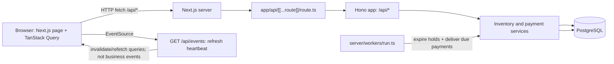
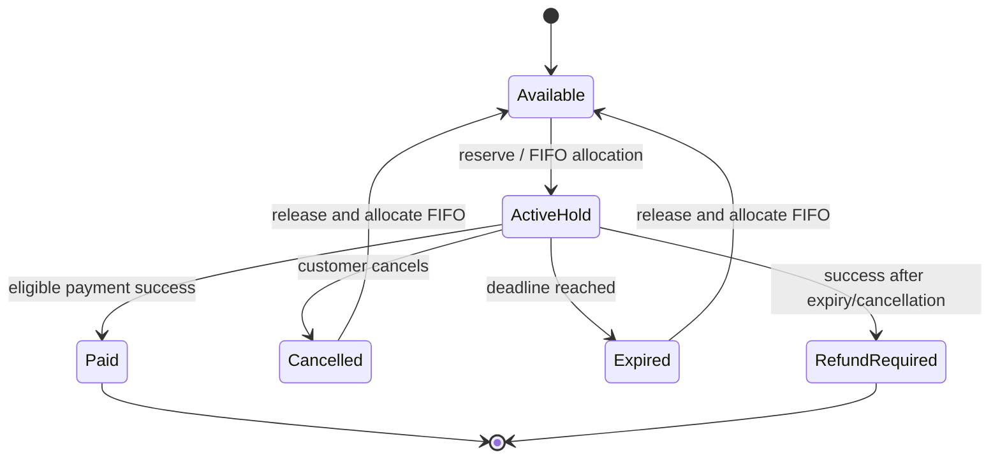
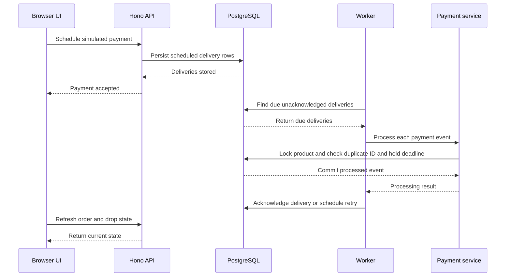

# Sneaker Drop — Architecture and Project Guide

This document is a guided map of the repository: what the application does,
how its parts communicate, what each project file is for, and which decisions
keep inventory and payment state consistent.

## At a glance

Sneaker Drop is a development demo for selling one limited edition of 20 pairs.
A customer can hold one pair for five minutes, join a FIFO waiting queue when
stock is unavailable, and purchase at most two pairs during the drop. Payment
is simulated, but reservations, orders, event deliveries, and inventory are
persisted in PostgreSQL.

There is one web application, not a separately deployed API: Next.js serves
the React storefront and adapts a Hono API at `/api/*`. A separate Node worker
process periodically expires holds, allocates released stock, and delivers
persisted simulated-payment events.

| Concern | Implementation |
| --- | --- |
| Web framework and UI | Next.js 16 App Router, React 19, TypeScript |
| HTTP API | Hono mounted through a Next.js catch-all route |
| Database and ORM | PostgreSQL 17, Prisma 7, PostgreSQL driver adapter |
| Request validation | Zod |
| Browser-side API state | TanStack Query |
| Styling and controls | Tailwind CSS 4 and local UI primitives |
| Background work | A separate TypeScript/Node polling process |
| Tests | Vitest against a dedicated, real PostgreSQL test database |
| Package manager | pnpm |

## Repository map

The diagram shows the application-owned source tree. `node_modules`, `.git`,
Next.js build output, and the generated Prisma client are not source files and
are intentionally not expanded here.

```mermaid
flowchart TB
  root["sneaker-drop/"]
  root --> app["app/"]
  app --> page["page.tsx — storefront"]
  app --> layout["layout.tsx — root layout and metadata"]
  app --> styles["globals.css — theme and Tailwind"]
  app --> favicon["favicon.ico"]
  app --> api["api/[[...route]]/route.ts — Hono adapter"]
  root --> components["components/ui/"]
  components --> alert["alert.tsx"]
  components --> badge["badge.tsx"]
  components --> button["button.tsx"]
  components --> card["card.tsx"]
  components --> label["label.tsx"]
  components --> select["native-select.tsx"]
  components --> table["table.tsx"]
  root --> controllers["controllers/"]
  controllers --> controller["payments.controller.ts — compatibility re-export"]
  root --> lib["lib/"]
  lib --> env["env.ts — dotenv loading"]
  lib --> prismaClient["prisma.ts — shared client"]
  lib --> utils["utils.ts — class helper re-export"]
  root --> server["server/"]
  server --> http["app.ts — routes and middleware"]
  server --> config["config.ts — validated runtime config"]
  server --> errors["errors.ts — typed application errors"]
  server --> services["services/"]
  services --> inventory["inventory.ts — holds, expiry, FIFO"]
  services --> payments["payments.ts — webhook and simulated gateway"]
  server --> workers["workers/run.ts — polling worker"]
  root --> prisma["prisma/"]
  prisma --> schema["schema.prisma"]
  prisma --> seed["seed.ts"]
  prisma --> migrations["migrations/ — SQL history and lock"]
  root --> tests["tests/"]
  tests --> apiTest["api.test.ts"]
  tests --> concurrencyTest["inventory.concurrency.test.ts"]
  tests --> reservationTest["reservation.test.ts"]
  tests --> queueTest["queue.test.ts"]
  tests --> paymentTest["payment.test.ts"]
  tests --> helpers["helpers.ts — database fixtures"]
  root --> scripts["scripts/"]
  scripts --> runner["test.mjs — guarded test runner"]
  scripts --> walkthrough["walkthrough.mjs — Playwright demo"]
  root --> public["public/ — starter SVG assets"]
  root --> docs["README.md, NOTES.md, ARCHITECTURE.md"]
  root --> projectConfig["package.json, pnpm lock/workspace, TypeScript, ESLint, Next, Vitest, Prisma, Docker, UI config"]
  root --> agentNotes[".agents/skills/ — local Prisma reference notes"]
```



## Runtime architecture



The worker is not an HTTP server and does not call back into Next.js. Both the
HTTP app and worker call the same service functions and use the same database
rules. The event stream is deliberately only an invalidation heartbeat; the
browser retrieves authoritative state with normal API requests.

### Request and identity boundary

- The Hono app has a `/api` base path; the Next.js route handler forwards
  `GET`, `POST`, and `DELETE` requests to it.
- `/health`, `/drop`, and `/events` are public. The drop response includes
  demo-user choices only when demo mode is enabled.
- The webhook uses a shared `Authorization` secret and does not use the demo
  user middleware.
- Other routes pass through the demo middleware. It requires `DEMO_MODE=true`
  and a valid `x-demo-user` ID. The browser stores the selected ID in local
  storage.
- This is intentional development impersonation, not production
  authentication, authorization, or a user session system.

## HTTP routes

There are **11 Hono endpoints**. All except the server-sent event stream return
JSON. API errors use `{ "error": { "code": "...", "message": "..." } }`.

| # | Method and path | Access | Purpose |
| ---: | --- | --- | --- |
| 1 | `GET /api/health` | Public | Executes a database query to check connectivity. |
| 2 | `GET /api/drop` | Public | Returns the product, stock, held/sold/waiting counts, current server time, and optionally demo users. |
| 3 | `GET /api/events` | Public SSE | Emits a `refresh` heartbeat every two seconds; it contains no user-specific data. |
| 4 | `POST /api/payments/webhook` | Webhook secret | Validates a payment event and processes it through the shared payment service. |
| 5 | `POST /api/reservations` | Demo user | Accepts `{}` and atomically holds one pair. |
| 6 | `GET /api/reservations/me` | Demo user | Returns the user's active/payment-pending hold and server time. |
| 7 | `DELETE /api/reservations/me` | Demo user | Cancels the user's hold and reallocates stock to the queue in the same transaction. |
| 8 | `POST /api/queue` | Demo user | Accepts `{}` and adds the user to the FIFO queue if stock is exhausted. |
| 9 | `GET /api/queue/me` | Demo user | Returns the user's waiting entry and its current one-based rank. |
| 10 | `POST /api/payments/simulate` | Demo user | Persists simulated payment deliveries for an owned order; responds `202`. |
| 11 | `GET /api/orders/me` | Demo user | Returns up to 100 most recent orders. |

The demo-user header is accepted only for known database user IDs. Request
bodies are validated with Zod. Invalid JSON or validation errors return 400;
application conflicts default to 409; unhandled server errors are logged and
returned as a generic 500 response. A Prisma uniqueness conflict is mapped to
`STATE_CONFLICT`.

## Business model and persisted state

The product ID is fixed as `sneaker-drop`. The seed creates it with a total of
20 pairs and creates 24 demo users. A pair is either available, held by an
active reservation, or sold by a paid order. The intended single-product
inventory equation is:

```text
availableStock + active reservation quantity + PAID order quantity = 20
```

Each reservation and order has quantity one. Each order belongs to exactly
one reservation. The purchase cap counts a user's `PAID` order quantities;
with one product in this demo, that is the per-drop purchase cap.

| Model | Role and important fields |
| --- | --- |
| `Product` | Edition and stock counters: `totalStock`, `availableStock`. |
| `User` | Demo identity, unique email, name, and demo marker. |
| `Reservation` | One-pair hold, owner/product, status, and `expiresAt`. |
| `Order` | One purchase attempt linked uniquely to a reservation; status and optional `paidAt`. |
| `QueueEntry` | Queue history and a PostgreSQL sequence-backed `position`. |
| `PaymentEvent` | Provider event ID, event type/payload, order, processing status, and timestamps. |
| `PaymentDelivery` | Durable fake-gateway event JSON, due time, acknowledgement, retry count, and last error. |

### State values

- Reservation status: `ACTIVE`, `PAYMENT_PENDING`, `EXPIRED`, `CONVERTED`,
  `CANCELLED`. Current service code creates `ACTIVE` reservations and converts,
  expires, or cancels them. `PAYMENT_PENDING` exists in the enum and is treated
  as a holding status, but this code does not currently transition a
  reservation into it.
- Queue status: `WAITING`, `ALLOCATED`, `COMPLETED`, `CANCELLED`. Allocation
  keeps the queue record as history; completion marks the end of the allocated
  hold, while ineligible entries are cancelled.
- Order status: `PENDING`, `PROCESSING`, `PAID`, `EXPIRED`, `CANCELLED`,
  `REFUND_REQUIRED`. The last status records a simulated compensation need;
  this project does not charge or issue real refunds.
- Payment event status: `RECEIVED`, `PROCESSED`, `IGNORED`, `FAILED`. The
  payment service persists accepted new events as `PROCESSED` or `IGNORED`.

### Reservation, queue, and expiry lifecycle



This is a conceptual view of one pair, not a literal table state machine:
allocation may transfer the released unit directly to the next eligible
queued user before the transaction commits, so no other request can take it
between release and allocation.

1. Every inventory-changing path acquires the product row with
   `SELECT ... FOR UPDATE` before checking eligibility or stock.
2. The service reads the time after acquiring the lock. In production this is
   PostgreSQL `clock_timestamp()`; tests can inject a deterministic clock.
3. Before reserve, queue join, cancellation, and payment processing, expired
   holds are reconciled. A hold becomes `EXPIRED`, its pending order becomes
   `EXPIRED`, and the released unit is allocated in FIFO order if a valid
   waiter exists.
4. Queue allocation skips users who now have an active hold or have reached
   the paid-purchase limit. A successful allocation creates a new reservation
   and pending order with a fresh five-minute deadline.
5. A reservation or queue request that fails rolls back its transaction,
   including any reconciliation performed earlier in that transaction. A
   worker tick or subsequent successful mutation can then commit that
   reconciliation.

The queue position is generated by PostgreSQL sequence, not wall-clock time.
Gaps in positions are expected. The queue endpoint returns a current rank by
counting earlier `WAITING` entries.

### Payment lifecycle



Supported simulation modes:

- `random`: variable delivery delay, possible reordering, optional duplicate
  success, and a probability of a late success.
- `out_of_order`: schedules success before processing and includes a duplicate
  success.
- `late`: schedules success two seconds after the hold deadline and includes
  a duplicate.

Event processing is serialized with inventory changes. A repeated provider
event ID with identical order/type is acknowledged as a duplicate; reusing an
ID for a different event returns `EVENT_ID_CONFLICT`. Distinct success IDs
cannot buy twice because a paid order is not transitioned again. A success is
accepted only while the hold is still active and strictly before its deadline.
If a success arrives too late or after cancellation, the old order becomes
`REFUND_REQUIRED`; it cannot take stock from a new holder. Provider timestamps
do not override the database deadline.

Deliveries are at-least-once: a worker crash after processing but before
acknowledgement can cause replay. Idempotent event processing makes that safe.
Failures are logged and saved on the delivery with a capped exponential retry
delay. The worker polls rows without an exclusive claim; multiple workers can
see a delivery, and event idempotency is the protection against duplicate
processing.

## Consistency and design decisions

| Decision | Reason and consequence |
| --- | --- |
| Keep one Next.js application and mount Hono inside it | The UI and HTTP API share deployment and origin; there is no separate Express/API server to operate. |
| Use PostgreSQL as the durable source of truth | Stock, holds, queue positions, payment events, and scheduled fake deliveries survive process restarts. |
| Lock the single product row before every state-changing inventory/payment operation | Serializes contenders across web and worker processes and gives all mutations one lock order. This is intentionally coarse but appropriate for one 20-pair drop. |
| Read database time after lock acquisition | A request waiting on the lock cannot act using a stale pre-lock timestamp to pay an expired hold. |
| Expire and allocate in one transaction | Prevents another buyer from bypassing the FIFO queue during stock release. |
| Persist simulated deliveries rather than using in-memory timers | Delayed events survive worker restarts and can be retried. |
| Treat webhook event IDs idempotently and check order state too | Handles webhook retries, duplicate deliveries, and distinct success event IDs without duplicate purchases. |
| Use a local demo-user header instead of adding real authentication | Keeps the demo easy to run but explicitly prevents production use as an auth design. |
| Test with real PostgreSQL and injected clocks | Exercises database locks and constraints without waiting for real five-minute holds. |

PostgreSQL enforces nonnegative stock bounded by 20, one-pair quantities, one
active/payment-pending reservation per user, one waiting queue entry per user,
unique order-per-reservation, unique queue position, and unique provider event
ID. Cross-table stock conservation and the paid purchase cap are protected by
the locked service transactions, not by a database trigger. Direct database
writes must preserve those invariants.

Mutation transactions use PostgreSQL's default `ReadCommitted` isolation; the
product-row lock serializes the state-changing paths. The drop summary and
queue-rank reads use `RepeatableRead` snapshots so their related counts or
position calculations are internally consistent.

The design targets one product. Adding products is not just adding rows: the
hard-coded `PRODUCT_ID` and global product lock would need to be replaced with
product-aware locking. A global purchase cap across products would also need a
documented user/product lock order or a dedicated per-user lock to avoid races
and deadlocks.

## Storefront behavior

`app/page.tsx` is a client-side single-page storefront. It:

- Fetches public drop inventory and optional demo users.
- Stores the selected demo ID in local storage and synchronizes tabs with
  browser storage events.
- Uses TanStack Query to fetch the current hold, queue position, and latest
  orders, polling every five seconds.
- Opens an `EventSource` to `/api/events`; refresh heartbeats invalidate
  queries so other users' actions become visible sooner. Polling remains the
  fallback.
- Displays an approximate countdown adjusted using the server time returned
  by the API. The backend, not this browser timer, decides payment eligibility.
- Allows reserve, queue, cancel, and simulated-payment actions and displays
  error/status messages.

The sneaker illustration is loaded from an external Unsplash URL in the page,
not from the local `public/` directory. The local SVGs are starter assets and
are not referenced by the storefront.

## Environment and local development

The app reads `.env.local` before `.env`; explicitly supplied process
environment values take precedence. `lib/env.ts` performs dotenv loading and
`server/config.ts` validates required values through Zod.

| Variable | Purpose |
| --- | --- |
| `DATABASE_URL` | PostgreSQL connection for the application and Prisma client. |
| `DIRECT_URL` | Optional direct migration connection; Prisma config falls back to `DATABASE_URL`. |
| `TEST_DATABASE_URL` | Dedicated database used by the destructive test runner; its database name must end in `_test`. |
| `DEMO_MODE` | Enables demo-user discovery and private demo-user middleware when `true`; defaults to `true`. |
| `PAYMENT_WEBHOOK_SECRET` | Shared secret for the simulated webhook; must be at least 16 characters. |
| `WORKER_INTERVAL_MS` | Worker tick delay in milliseconds; must be an integer of at least 100 and defaults to 1000. |
| `DEMO_URL` | Optional base URL for the browser walkthrough; defaults to `http://localhost:3100`. |
| `PLAYWRIGHT_CHROMIUM_EXECUTABLE` | Optional installed Chromium executable for the walkthrough. |

`.env.example` documents variable names and local defaults. A local `.env`
may exist but is ignored and is not documented or read as part of this guide.
Never commit actual credentials.

Typical fresh-checkout setup:

```sh
pnpm install
cp .env.example .env.local
pnpm db:up
pnpm db:generate
pnpm db:migrate
pnpm db:seed
pnpm dev
```

Run `pnpm dev:workers` in a second terminal. Compose exposes the development
database on loopback port 55432 using a named persistent volume and the
isolated test database on loopback port 55433 using temporary storage. The
worker is needed for proactive expiry and payment delivery; API mutations
also reconcile expired holds when they run.

### Package scripts

| Script | What it runs |
| --- | --- |
| `pnpm dev` | Next.js development server. |
| `pnpm build` | Next.js production build. |
| `pnpm start` | Next.js production server after build. |
| `pnpm lint` | ESLint. |
| `pnpm typecheck` | TypeScript compiler with no emitted files. |
| `pnpm test` / `pnpm test:watch` | Guarded PostgreSQL test runner, one-shot or watch mode. |
| `pnpm db:up` | Starts Compose development and test PostgreSQL containers and waits for health checks. |
| `pnpm db:generate` | Generates the Prisma client under `app/generated/prisma/`. |
| `pnpm db:migrate` | Applies committed migrations to the configured database. |
| `pnpm db:seed` | Idempotently creates the product and demo users without resetting stock/state. |
| `pnpm dev:workers` | Runs the worker with `tsx watch`. |
| `pnpm workers` | Runs the worker process directly. |
| `pnpm demo:record` | Runs the Playwright walkthrough and writes ignored media under `artifacts/`. |

The test runner refuses to run unless the database name ends in `_test`, then
applies migrations and invokes Vitest with that connection. Tests truncate
tables between cases. Do not point `TEST_DATABASE_URL` at data that should be
preserved.

## Tests and what they protect

All database tests use the real PostgreSQL schema and a deterministic test
clock in `tests/helpers.ts`.

| Test file | Focus |
| --- | --- |
| `tests/api.test.ts` | HTTP routes, demo auth, invalid inputs, reservation actions, webhook authentication, validation, and duplicate event retry. |
| `tests/inventory.concurrency.test.ts` | 1,000 simultaneous reservation requests, exactly 20 successful holds, and database rejection of negative stock. |
| `tests/reservation.test.ts` | Same-user races, two-pair cap, partial unique index, repeated expiry, payment/expiry race, cancellation/payment race, and rollback. |
| `tests/queue.test.ts` | FIFO allocation, fresh holds, simultaneous workers, fairness after worker downtime, skipped ineligible users, cancellation allocation, and idempotent queue entry. |
| `tests/payment.test.ts` | Duplicate/out-of-order events, late payment after reassignment, cancelled reservation, delivery replay, event ID collision, order ownership, and one simulation per order. |
| `tests/helpers.ts` | Creates isolated users/product, protects against a non-test database, provides clocks, and checks the stock equation. |

`scripts/walkthrough.mjs` is an end-to-end browser demonstration, not a test
runner. It reserves and pays as a demo user, checks persisted identity and hold
deadline after reload, checks mobile overflow, and writes screenshots/video.
It consumes a paid demo pair in whichever development database it uses.

## File-by-file reference

### App Router and browser UI

| File | Responsibility |
| --- | --- |
| [`app/page.tsx`](app/page.tsx) | Storefront page, client state, API calls, polling, countdown, demo identity selection, queue/reservation/payment controls, and order history. |
| [`app/layout.tsx`](app/layout.tsx) | Root HTML/body layout and page metadata. |
| [`app/globals.css`](app/globals.css) | Tailwind imports, theme color/radius tokens, light/dark variables, and global base styling. |
| [`app/api/[[...route]]/route.ts`](app/api/[[...route]]/route.ts) | Adapts the shared Hono app to Next.js for `GET`, `POST`, and `DELETE`. |
| [`app/favicon.ico`](app/favicon.ico) | Browser tab icon. |

### API and services

| File | Responsibility |
| --- | --- |
| [`server/app.ts`](server/app.ts) | Hono API, all 11 routes, demo-user middleware, webhook auth, validation, error mapping, and SSE heartbeats. |
| [`server/errors.ts`](server/errors.ts) | `AppError`, carrying a stable code and HTTP status for business-rule errors. |
| [`server/config.ts`](server/config.ts) | Parses and validates runtime environment configuration. |
| [`server/services/inventory.ts`](server/services/inventory.ts) | Product-row locking, eligibility, reservation creation, cancellation, expiry reconciliation, FIFO allocation, and queue joining. |
| [`server/services/payments.ts`](server/services/payments.ts) | Payment event schemas, idempotent event processing, fake delivery scheduling, worker delivery/retry, and late-payment compensation state. |
| [`server/workers/run.ts`](server/workers/run.ts) | Worker loop, configured interval, graceful SIGINT/SIGTERM stop, expiry tick, payment delivery tick, and database disconnect. |
| [`controllers/payments.controller.ts`](controllers/payments.controller.ts) | Compatibility re-export of payment processing as `ExecuteDummyPayment`; the active Hono route calls the service directly. |

### Persistence and environment

| File | Responsibility |
| --- | --- |
| [`prisma/schema.prisma`](prisma/schema.prisma) | Prisma models, enums, relations, indexes, and generated-client output location. |
| [`prisma/migrations/202610180001_initial/migration.sql`](prisma/migrations/202610180001_initial/migration.sql) | Initial PostgreSQL schema, enums, ordinary indexes, and foreign keys. |
| [`prisma/migrations/202610180002_invariants/migration.sql`](prisma/migrations/202610180002_invariants/migration.sql) | Database checks and partial unique indexes for inventory/active-hold/waiting-entry constraints. |
| [`prisma/migrations/migration_lock.toml`](prisma/migrations/migration_lock.toml) | Prisma migration provider marker (`postgresql`). |
| [`prisma/seed.ts`](prisma/seed.ts) | Upserts Edition 001 and 24 demo users without resetting existing inventory. |
| [`prisma.config.ts`](prisma.config.ts) | Prisma CLI schema/migration/seed paths and migration database URL selection. |
| [`lib/env.ts`](lib/env.ts) | Loads `.env.local` and `.env` using dotenv. |
| [`lib/prisma.ts`](lib/prisma.ts) | Creates the Prisma client with the PostgreSQL adapter and reuses it across hot reloads outside production. |
| [`lib/utils.ts`](lib/utils.ts) | Re-exports the `cn` class-name utility. |
| [`.env.example`](.env.example) | Safe local template showing required/optional configuration variables. |
| [`docker-compose.yml`](docker-compose.yml) | Local development PostgreSQL and isolated test PostgreSQL services. |

`app/generated/prisma/` is generated by `pnpm db:generate`/the package
postinstall script, ignored by Git, and therefore not hand-maintained source.

### Reusable UI components

| File | Responsibility |
| --- | --- |
| [`components/ui/alert.tsx`](components/ui/alert.tsx) | Default/destructive alert, title, description, and action primitives. |
| [`components/ui/badge.tsx`](components/ui/badge.tsx) | Variant-based badge primitive using Base UI render support. |
| [`components/ui/button.tsx`](components/ui/button.tsx) | Button primitive with shared visual and size variants. |
| [`components/ui/card.tsx`](components/ui/card.tsx) | Card, header, title, description, action, content, and footer primitives. |
| [`components/ui/label.tsx`](components/ui/label.tsx) | Styled native label. |
| [`components/ui/native-select.tsx`](components/ui/native-select.tsx) | Styled native select, option, and option-group elements. |
| [`components/ui/table.tsx`](components/ui/table.tsx) | Responsive table and semantic table-section/cell primitives. |

### Tests, scripts, and project configuration

| File | Responsibility |
| --- | --- |
| [`tests/api.test.ts`](tests/api.test.ts) | HTTP-level API tests. |
| [`tests/inventory.concurrency.test.ts`](tests/inventory.concurrency.test.ts) | High-concurrency inventory and database constraint tests. |
| [`tests/reservation.test.ts`](tests/reservation.test.ts) | Reservation, purchase-cap, expiry, cancellation, and race tests. |
| [`tests/queue.test.ts`](tests/queue.test.ts) | Queue and FIFO allocation tests. |
| [`tests/payment.test.ts`](tests/payment.test.ts) | Payment event, simulation delivery, idempotency, and late-payment tests. |
| [`tests/helpers.ts`](tests/helpers.ts) | Shared test fixtures, safe database truncation, deterministic clocks, and invariant check. |
| [`scripts/test.mjs`](scripts/test.mjs) | Ensures the configured test DB ends in `_test`, applies migrations, then starts Vitest. |
| [`scripts/walkthrough.mjs`](scripts/walkthrough.mjs) | Playwright end-to-end demo; creates screenshot/video artifacts and a paid order. |
| [`vitest.config.mts`](vitest.config.mts) | Test file selection, serial file execution, and test/hook timeouts. |
| [`package.json`](package.json) | Package identity, dependency versions, and all developer scripts. |
| [`pnpm-lock.yaml`](pnpm-lock.yaml) | Exact dependency resolution for reproducible pnpm installs. |
| [`pnpm-workspace.yaml`](pnpm-workspace.yaml) | pnpm workspace settings; this repository currently has no package globs. |
| [`tsconfig.json`](tsconfig.json) | Strict TypeScript settings, Next plugin, and `@/*` root alias. |
| [`next.config.ts`](next.config.ts) | Enables Next.js cache components/partial prefetching and configures Tailwind's Turbopack CSS loader. |
| [`eslint.config.mjs`](eslint.config.mjs) | Next.js Core Web Vitals and TypeScript ESLint presets plus generated-output ignores. |
| [`components.json`](components.json) | UI generator style, aliases, CSS entry point, and icon-library configuration. |
| [`.gitignore`](.gitignore) | Excludes dependencies, generated/build outputs, environment files, and walkthrough artifacts. |
| [`.vscode/settings.json`](.vscode/settings.json) | Prisma VS Code extension preferences and pnpm script runner. |
| [`AGENTS.md`](AGENTS.md) | Repository-specific agent instruction file; includes Next.js-specific guidance. |
| [`.agents/skills/prisma-composer-core-concepts/SKILL.md`](.agents/skills/prisma-composer-core-concepts/SKILL.md) | Local reference for Prisma Composer; reference material, not app runtime code. |
| [`.agents/skills/prisma-platform-core-concepts/SKILL.md`](.agents/skills/prisma-platform-core-concepts/SKILL.md) | Local reference for Prisma Platform; reference material, not app runtime code. |
| [`README.md`](README.md) | Short project summary, quick-start commands, and links to deeper notes. |
| [`NOTES.md`](NOTES.md) | Existing detailed setup, API, concurrency, payment, test, and production-limit notes. |
| [`ARCHITECTURE.md`](ARCHITECTURE.md) | This architecture guide and repository file reference. |

### Static public assets

| File | Responsibility |
| --- | --- |
| [`public/file.svg`](public/file.svg) | Starter file/document icon; not used by the storefront. |
| [`public/globe.svg`](public/globe.svg) | Starter globe icon; not used by the storefront. |
| [`public/next.svg`](public/next.svg) | Next.js wordmark asset; not used by the storefront. |
| [`public/vercel.svg`](public/vercel.svg) | Vercel triangle asset; not used by the storefront. |
| [`public/window.svg`](public/window.svg) | Starter window icon; not used by the storefront. |

## Production limitations

This code is an explicitly simulated, single-product development demo. Before
using it for real commerce, replace demo impersonation with verified
authentication and authorization; integrate provider-signed webhooks and real
payment/refund operations; add rate limiting/admission control, monitoring,
alerts, operations tooling and an exhausted-retry/dead-letter policy; and
load-test the target PostgreSQL deployment. The single-product row lock is
correctness-oriented and is not a multi-product scaling strategy.

## Further reading

- [`README.md`](README.md) for the shortest setup path.
- [`NOTES.md`](NOTES.md) for expanded operational detail, example API calls,
  test history, and the browser walkthrough.
